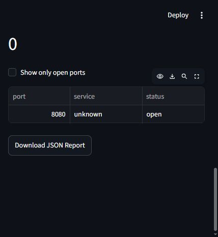
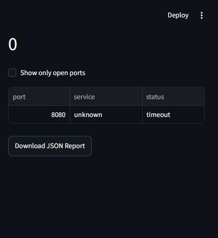
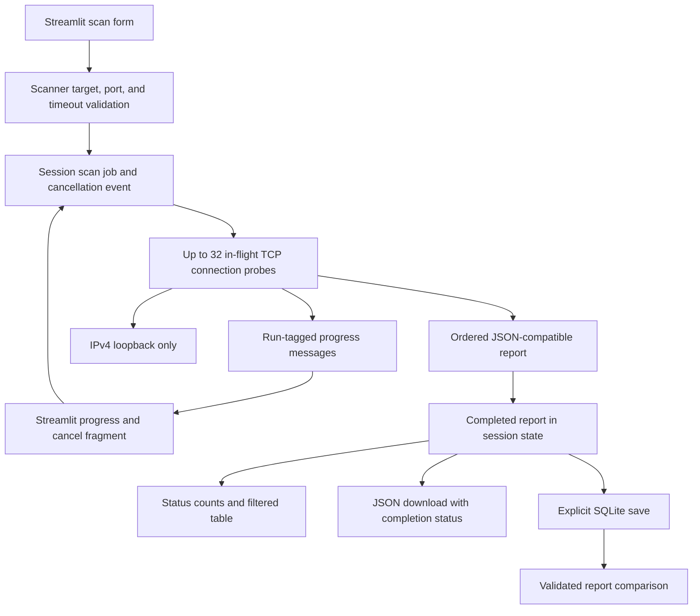

# NetScope portfolio demonstration

This demonstration checks one HTTP server on `127.0.0.1:8080`, then checks the
same port after stopping that server. The server served a newly created empty
temporary folder. No external hosts were scanned and nothing was deployed.

## Recorded results

Captured on 24 October 2026 using Windows, Python 3.14.7, and Streamlit 1.66.1.
Both scans used target `127.0.0.1`, start/end port `8080`, and a 2-second timeout.

| Server state | Open | Closed | Timeout | Error | Observed result |
| --- | --- | --- | --- | --- | --- |
| Running | 1 | 0 | 0 | 0 | `open` |
| Stopped | 0 | 0 | 1 | 0 | `timeout` |

The stopped-server result was **timeout**, not connection refused. It is the
actual observation and was not changed to `closed`. Other operating systems or
network settings can return an explicit refusal, which NetScope labels `closed`.
A timeout alone does not prove whether a port is closed or filtered.

## Screenshots and reports

These are actual dashboard screenshots and downloads from the same two scans.
The screenshots show the result table and download control in the available
browser viewport. Reports contain only a loopback address, one port, conventional
service label, scan timestamps, timings, counts, and outcomes. They contain no
usernames, machine names, file paths, credentials, or external addresses.

### Server running



[Open-port JSON report](../examples/localhost-open.json)

### Server stopped



[Stopped-server JSON report](../examples/localhost-stopped.json)

Both reports show service `unknown`: the operating system's conventional service
lookup did not provide a label for port 8080. The controlled server was HTTP, but
NetScope does not inspect application traffic to identify software. These are
historical example reports; a new run will have different timestamps and timings.

## Reproduce it

Follow the [README installation and startup instructions](../README.md) first.
Start the dashboard in one terminal, then open a second PowerShell terminal:

```powershell
cd D:\Project\NetScope
$demoPython = (Resolve-Path .\.venv\Scripts\python.exe).Path
$demoFolder = Join-Path ([System.IO.Path]::GetTempPath()) ("netscope-demo-" + [guid]::NewGuid().ToString("N"))
New-Item -ItemType Directory -Path $demoFolder | Out-Null
Set-Location -LiteralPath $demoFolder
& $demoPython -m http.server 8080 --bind 127.0.0.1
```

1. In the dashboard, use target `127.0.0.1`, start/end port `8080`, and timeout `2`.
2. Click **Start Scan**. The result should be `open`; download the JSON report.
3. In the HTTP server terminal, press **Ctrl+C** and wait for the prompt to return.
4. Scan the same port again and download the new report. Expect a refusal or timeout
   unless another process has started listening on that port.
5. Compare the tables and reports. An `error` requires checking its message;
   it is not interchangeable with `closed`.
6. Stop the dashboard with **Ctrl+C** in its terminal when finished.

If port 8080 is occupied, choose another available port in both the HTTP command
and dashboard. Serve an empty folder so the demonstration does not expose personal
files. Use only a machine you own or have explicit permission to test.

## Architecture



`app.py` owns the form, session report, UI fragment, presentation, and download.
`jobs.py` owns the finite coordinator thread and run-tagged queue. `scanner.py`
owns target validation, port/time limits, socket lifetimes, connection outcomes,
and report construction. The boolean `scan_port()` helper remains available, and
`scan_target()` without a range preserves the original eight-port selection.
`.streamlit/config.toml` supplies the dashboard's loopback default. The
[test suite](../tests/README.md) covers scanner boundaries and dashboard behavior.

## Limitations

- Only the exact strings `127.0.0.1` and `localhost` are accepted, both pinned to
  IPv4 loopback. There is no IPv6, LAN, or remote-host scanning.
- A successful TCP handshake establishes reachability at that moment, not
  vulnerability, identity, or permission to use the listening service.
- Service labels are conventional assignments from the OS, not detected software.
- Scans use TCP connections without application payloads. There are no UDP scans,
  banner checks, exploitation, password guessing, or vulnerability assessments.
- The 0.05–2 second timeout applies to each connection, not the entire scan.
  At most 1,024 ports and 32 concurrent connections are allowed per scan; separate
  dashboard sessions can run separate scans.
- Reports are point-in-time observations. Progress and cancellation are available;
  only an explicit save keeps a report in local history. Cancelled reports contain
  completed probes and mark remaining requested ports as not scanned. History is
  unencrypted; comparison does not establish continuous service availability.
- Python 3.14.7 on Windows was verified. Other documented Python versions and
  operating systems have not yet been verified.

## Engineering takeaways

- Validate at the socket boundary so direct helper calls receive the same safety
  restrictions as the dashboard. Pinning localhost to a literal avoids DNS lookup.
- Preserve refusal, timeout, and other errors as distinct outcomes. The stopped
  server in this demonstration shows why unsuccessful connections need context.
- Bound concurrent work while retaining result order, and close sockets on every
  path. Counts and the compatible `open_ports` list should agree with full results.
- Store one completed report in session state so filtering does not trigger new
  probes or silently change the downloadable data.
- Combine real ephemeral local listeners with controlled failures in tests;
  neither fixed-port assumptions nor external services are needed for the suite.

The screenshots and reports demonstrate the implemented scanner. They do not
constitute a security audit. Both temporary demonstration servers were stopped
after capture. Public deployment and external scanning remain outside scope.
